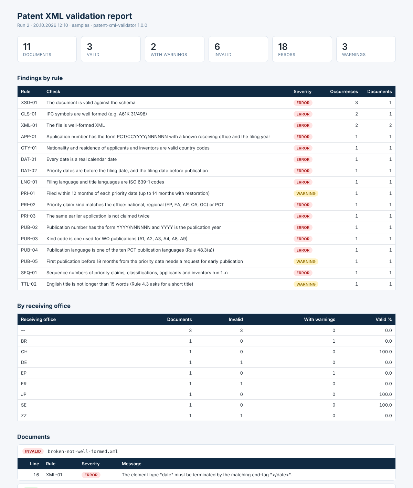

# patent-xml-validator

[](https://github.com/Zuzz001zu/patent-xml-validator/actions/workflows/ci.yml)

Command-line tool that checks the bibliographic data of international (PCT) patent
publications delivered as XML. It validates the structure against an XML schema, applies
PCT business rules, stores the results in a SQL database and produces a report that tells
the person correcting the data exactly which line is wrong and why.



## Why

Bibliographic data of a PCT publication comes from receiving offices, filing software and
manual data entry. A document can be perfectly valid XML and still be wrong: a priority
date after the filing date, an application number whose year does not match the filing
year, a kind code that is never used for WO publications, the same priority claimed twice.
Schema validation does not catch any of these.

This tool checks both levels and keeps the history of every run, so that recurring
problems can be traced back to their source (for example, to a receiving office).

## What it checks

**Structure** (rules run only when the structure is valid)

| Rule | Check |
|---|---|
| XML-01 | The file is well-formed XML. DOCTYPE declarations are refused (XXE protection) |
| XSD-01 | The document is valid against [the schema](src/main/resources/schema/patent-document.xsd) |

**Business rules**

| Rule | Severity | Check | Basis |
|---|---|---|---|
| PUB-01 | error | Publication country is WO | |
| PUB-02 | error | Publication number is `YYYY/NNNNNN` and `YYYY` is the publication year | |
| PUB-03 | error | Kind code is one used for WO publications (A1, A2, A3, A4, A8, A9) | ST.16 |
| PUB-04 | error | Publication language is one of the ten PCT publication languages | Rule 48.3(a) |
| PUB-05 | warning | First publication before 18 months from the priority date | Art. 21(2) |
| APP-01 | error | Application number is `PCT/CCYYYY/NNNNNN`, `CC` a receiving office, `YYYY` the filing year | |
| APP-02 | warning | A national receiving office matches the nationality or residence of an applicant | Rule 19.1, 19.4 |
| DAT-01 | error | Dates exist in the calendar (`20250231` passes the schema, not this rule) | |
| DAT-02 | error | Priority date < filing date ≤ publication date | |
| PRI-01 | error / warning | Filed within 12 months of each priority date; 12-14 months is a warning (restoration) | Art. 8, Rule 26bis.3 |
| PRI-02 | error | Priority kind matches the office: national, regional (EP, EA, AP, OA, GC) or PCT | |
| PRI-03 | error | The same earlier application is not claimed twice (`24183011.1` = `24 183 011.1`) | |
| CLS-01 | error | IPC symbols are well formed (`A61K 31/496`) | |
| SEQ-01 | error | `sequence` attributes run 1..n without gaps or repeats | |
| CTY-01 | error | Nationality and residence are valid country codes | ST.3 |
| LNG-01 | error | Language codes are ISO 639-1 | |
| TTL-01 | error | A title exists in the publication language, at most one per language | |
| TTL-02 | warning | English title is not longer than 15 words | Rule 4.3 |

*Errors* must be corrected, *warnings* need a human decision (for example, whether
restoration of the right of priority was requested).

## Quick start

Requires Java 21 and Maven.

```bash
mvn package
java -jar target/patent-xml-validator-1.1.0.jar validate samples
```

```text
INVALID  broken-not-well-formed.xml               1 error(s), 0 warning(s)
VALID    wo2025-118204-lemanis-therapeutics.xml   0 error(s), 0 warning(s)
...
WARNING  wo2025-124415-andina-agro.xml            0 error(s), 2 warning(s)
INVALID  wo2025-130412-claim-errors.xml           3 error(s), 0 warning(s)
INVALID  xxe-attempt.xml                          1 error(s), 0 warning(s)

12 documents: 3 valid, 3 with warnings, 6 invalid (run 1)
Report: /…/validation-report.html
```

Options:

```text
validate <file-or-folder>... [--db <path>] [--report <file>] [--csv <file>] [--fail-on error|warning|never]
rules        list the rules
--version
```

Exit codes: `0` nothing blocking, `1` findings at or above `--fail-on`, `2` usage or I/O
error. This makes the tool usable as a gate in a batch job or a pipeline.

## How it works

```text
XML file ─► secure SAX parser + XSD ─► DOM with line numbers ─► model (records)
                     │                                              │
              structural errors                               business rules
                     └──────────────► findings ◄────────────────────┘
                                         │
                       H2 database (JDBC) ─► SQL summaries ─► HTML report, CSV
```

- **Two passes.** Business rules run only on documents that are valid against the schema.
  Otherwise one missing element would produce a cascade of meaningless findings.
- **Line numbers.** The standard DOM builder loses them, so the DOM is built from SAX
  events and every element keeps its line ([`LocatingDomBuilder`](src/main/java/io/github/zuzz001zu/patentxml/xml/LocatingDomBuilder.java)).
  All schema violations of a file are reported at once, not only the first one.
- **Untrusted input.** DOCTYPE declarations, external entities and XInclude are disabled,
  which blocks XXE and entity-expansion attacks. Both cases are covered by tests and by a sample file.
- **Rules are small classes** implementing one interface, each with its own tests. Adding a
  rule means writing one class and registering it in `Rules`.
- **Results in SQL.** Each run, document and finding is stored through plain JDBC in one
  transaction. The report summaries are SQL queries kept in
  [`src/main/resources/db/queries`](src/main/resources/db/queries): findings by rule,
  quality by receiving office and the history of previous runs. The default database is an
  H2 file; any JDBC database with the same schema can be used.

## Sample data

[`samples/`](samples) contains twelve fictional publications (applicants, numbers and
inventors are invented): three valid ones, three with warnings and six with typical errors,
including a file that is not well-formed and an XXE attempt. `SamplesTest` checks that each
file gives exactly the expected findings, so the samples also serve as regression tests.

## Scope and limitations

- The schema is a **reduced subset** with ST.36 element names. It covers the fields used by
  the rules and is not a replacement for the official WIPO ST.36 / ST.96 schemas.
- Time limits do not take into account the extension when a period ends on a day the
  office is closed (Rule 80.5).
- Receiving office codes are checked against country codes plus IB, EP, EA, AP and OA, not
  against the current list of receiving offices. The competence check (APP-02) covers national
  offices only; regional offices would need the list of their member states.

## Project structure

```text
src/main/java/io/github/zuzz001zu/patentxml/
  Main.java               command line
  DocumentValidator.java  structure first, then rules
  xml/                    secure parsing, line numbers, DOM to model
  model/                  records for the bibliographic data
  rules/                  one class per rule, code lists, dates
  store/                  JDBC storage and report queries
  report/                 HTML report and CSV export
src/main/resources/
  schema/                 XSD
  db/                     schema.sql and the report queries
src/test/java/            unit tests per rule, parser, storage, report, CLI, samples
```

## Tests

```bash
mvn verify
```

CI builds the project, runs the tests, validates the sample files and publishes the HTML
report as a workflow artifact.

## License

MIT
